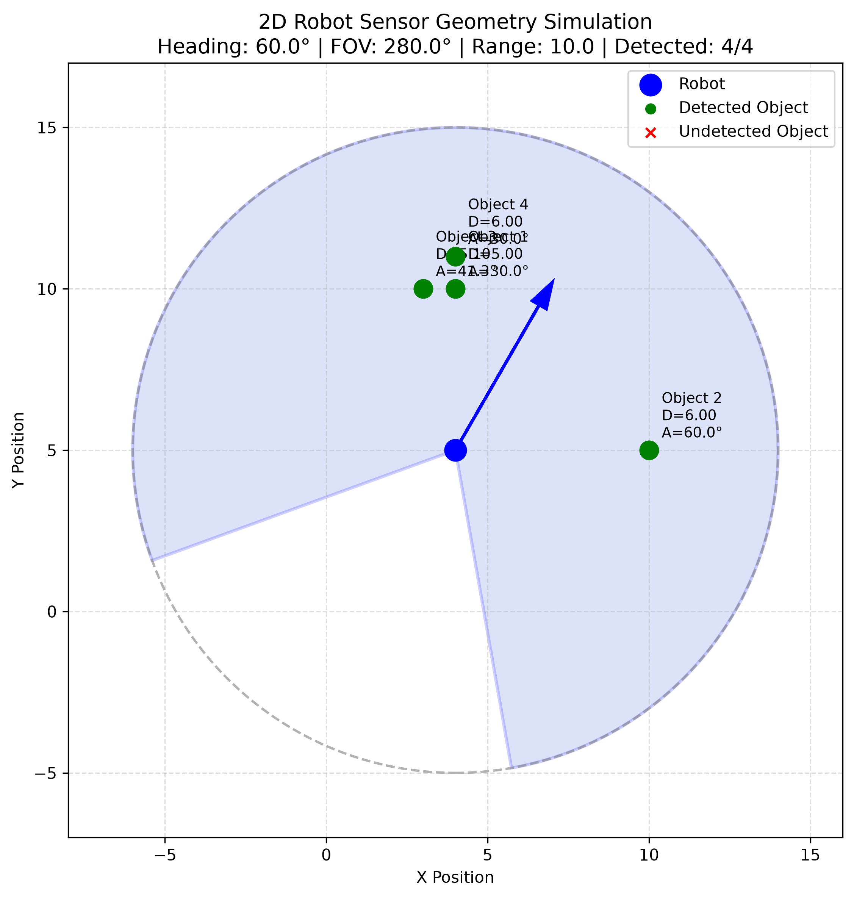

# MicroProject-02-Robot-Sensory-Geometry

A Python-based 2D robot sensor simulation that uses vector mathematics to detect objects within a configurable sensing range and field of view (FOV).

The project demonstrates fundamental concepts used in robotics, including relative positioning, Euclidean distance, vector normalization, dot products, angular calculations, projections, and geometric object detection.

## Project Overview

A robot equipped with a directional sensor must determine whether nearby objects fall within its sensing region.

This simulator models a robot in a two-dimensional environment and evaluates object visibility using two geometric conditions:

1. The object must be within the sensor's maximum detection range.
2. The object must lie within the sensor's field of view.

An object is detected only when both conditions are satisfied.

The simulator accepts user-defined inputs, calculates detection results, and generates a visualization using Matplotlib.

## Features

- Interactive robot position configuration
- Configurable sensor heading angle
- Adjustable sensor detection range
- Adjustable field of view from 0° to 360°
- Support for multiple object coordinates
- Euclidean distance calculations
- Relative position and vector normalization
- Dot product and angular calculations
- Vector projection
- Object detection based on range and FOV
- Floating-point tolerance for boundary comparisons
- 2D sensor visualization using Matplotlib
- Automatic saving of simulation results
- Automated unit testing with pytest

## Mathematical Foundations

### 1. Relative Position

Given robot position \(R=(x_r,y_r)\) and object position \(O=(x_o,y_o)\), the relative position is:

\[
\vec{v}=O-R
\]

### 2. Euclidean Distance

The distance between the robot and an object is:

\[
d=\sqrt{(x_o-x_r)^2+(y_o-y_r)^2}
\]

An object is within sensor range when:

\[
d\leq r_{\max}
\]

### 3. Sensor Direction

For sensor heading angle \(\theta\), the sensor direction vector is:

\[
\vec{s}=
\begin{bmatrix}
\cos\theta\\
\sin\theta
\end{bmatrix}
\]

Angles are converted from degrees to radians before evaluating trigonometric functions.

### 4. Angle Between Vectors

The angle between the sensor direction and the relative object position is calculated using the dot product:

\[
\alpha=\cos^{-1}\left(
\frac{\vec{s}\cdot\vec{v}}
{\|\vec{s}\|\|\vec{v}\|}
\right)
\]

### 5. Field-of-View Detection

An object is inside the sensor's field of view when:

\[
\alpha\leq\frac{\mathrm{FOV}}{2}
\]

### 6. Final Detection Condition

An object is detected when:

\[
\mathrm{Detected}=
(d\leq r_{\max})
\land
\left(\alpha\leq\frac{\mathrm{FOV}}{2}\right)
\]

Small numerical tolerances are applied to boundary comparisons to account for floating-point precision.

## Visualization

The simulator generates a 2D plot displaying:

- **Blue marker:** Robot position
- **Blue arrow:** Sensor heading direction
- **Light-blue sector:** Sensor field of view
- **Dashed circle:** Maximum sensing range
- **Green markers:** Detected objects
- **Red markers:** Undetected objects



The generated image is saved to `results/sensor_detection.png`.

## Project Structure

```text
MicroProject-02-Robot-Sensor-Geometry/
├── main.py
├── README.md
├── requirements.txt
├── .gitignore
├── src/
│   ├── __init__.py
│   ├── sensor_geometry.py
│   └── visualization.py
├── tests/
│   └── test_sensor_geometry.py
└── results/
    └── sensor_detection.png
```

**main.py:** Collects user inputs, executes the simulation, displays detection results, and calls the visualization function.

**src/sensor_geometry.py:** Implements the vector mathematics, sensor geometry, and object detection algorithms.

**src/visualization.py:** Generates and saves the 2D sensor detection visualization.

**tests/test_sensor_geometry.py:** Contains automated tests for mathematical operations, detection logic, and boundary conditions.

**results/:** Stores the generated simulation image.

## Installation

### 1. Clone the repository

```bash
git clone https://github.com/YOUR_USERNAME/MicroProject-02-Robot-Sensor-Geometry.git
cd MicroProject-02-Robot-Sensor-Geometry
```

Replace `YOUR_USERNAME` with your GitHub username.

Alternatively, download the repository as a ZIP file and extract it.

### 2. Create a virtual environment

```bash
python3 -m venv .venv
```

Activate it on macOS or Linux:

```bash
source .venv/bin/activate
```

On Windows:

```powershell
.venv\Scripts\activate
```

### 3. Install dependencies

```bash
python -m pip install -r requirements.txt
```

## Usage

Run the simulator from the project root:

```bash
python main.py
```

The program prompts for:

1. Robot X and Y coordinates
2. Sensor heading angle
3. Maximum detection range
4. Field-of-view angle
5. Number of objects
6. X and Y coordinates for each object

### Example Configuration

| Parameter | Value |
|---|---|
| Robot position | (0, 0) |
| Sensor heading | 0° |
| Sensor range | 10 |
| Field of view | 90° |
| Object 1 | (5, 0) |
| Object 2 | (5, 5) |
| Object 3 | (0, 5) |
| Object 4 | (12, 0) |
| Object 5 | (-3, 0) |

### Expected Results

| Object | Distance | Angle | Detected |
|---|---:|---:|---|
| 1 | 5.00 | 0° | Yes |
| 2 | 7.07 | 45° | Yes |
| 3 | 5.00 | 90° | No |
| 4 | 12.00 | 0° | No |
| 5 | 3.00 | 180° | No |

**Total objects:** 5  
**Detected objects:** 2  
**Undetected objects:** 3

## Automated Testing

The project uses pytest to validate mathematical calculations and sensor detection behavior.

Run the test suite using:

```bash
python -m pytest tests/test_sensor_geometry.py -v
```

The latest local test execution completed successfully:

**56 tests passed.**

The tests cover:

- Relative position calculations
- Euclidean distances
- Vector normalization
- Sensor direction vectors
- Dot products
- Angular calculations
- Vector projections
- Sensor range checks
- Field-of-view boundaries
- Single-object detection
- Multiple-object detection
- Invalid inputs and numerical edge cases

## Technologies Used

- Python
- NumPy
- Matplotlib
- pytest

## Limitations

This is a simplified geometric sensor simulator rather than a physical sensor model.

The current implementation does not account for obstacles blocking the sensor, measurement noise, object dimensions, sensor uncertainty, or moving objects.

## Future Improvements

- Obstacle occlusion and line-of-sight detection
- Sensor measurement noise
- Dynamic object movement
- Multiple sensors
- Animated sensor scanning
- Integration with robot navigation algorithms

## Learning Outcomes

This project strengthens practical understanding of:

- Vector mathematics for robotics
- Coordinate geometry
- Sensor modeling
- Geometric visibility calculations
- Numerical precision
- Modular Python development
- Scientific visualization
- Automated software testing

## Project Series

This repository is part of a series of Python-based microprojects exploring artificial intelligence, robotics, mathematics, and autonomous systems.

**MicroProject 01:** 2D Autonomous Robot Navigation

**MicroProject 02:** Robot Sensor Geometry Simulator

**MicroProject 03:** Two-Link Robotic Arm Simulator — Forward Kinematics

## License

No license is currently specified. All rights are reserved unless a license is added to the repository.